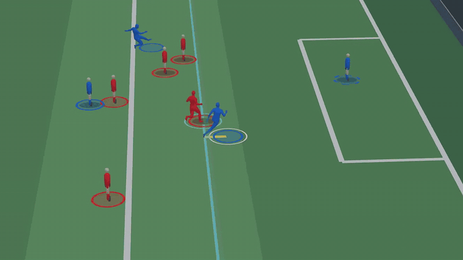
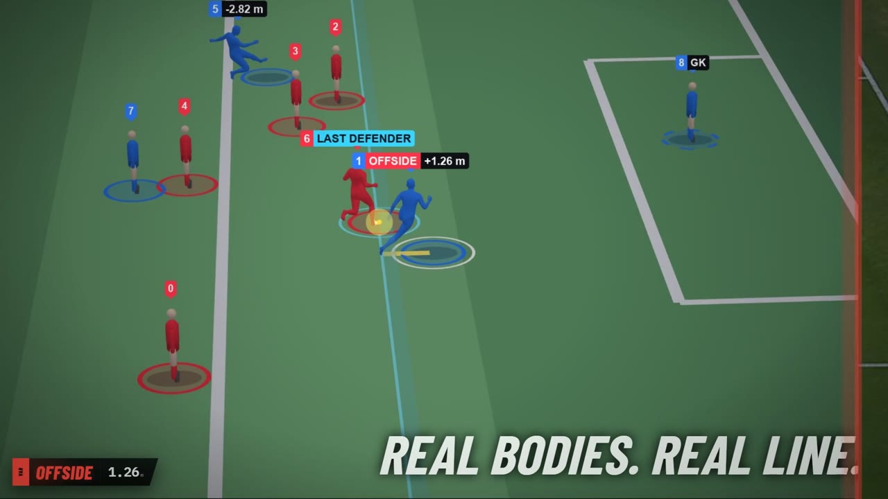
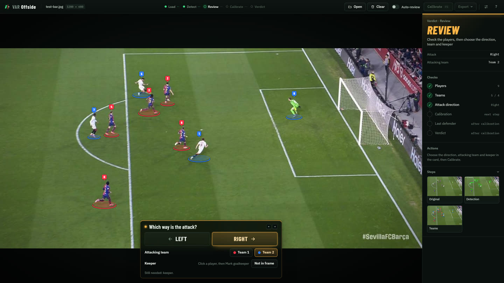
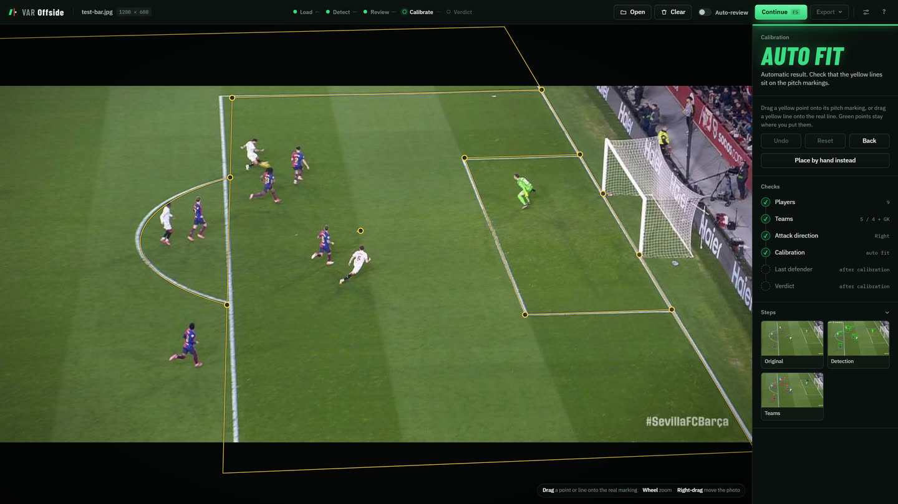
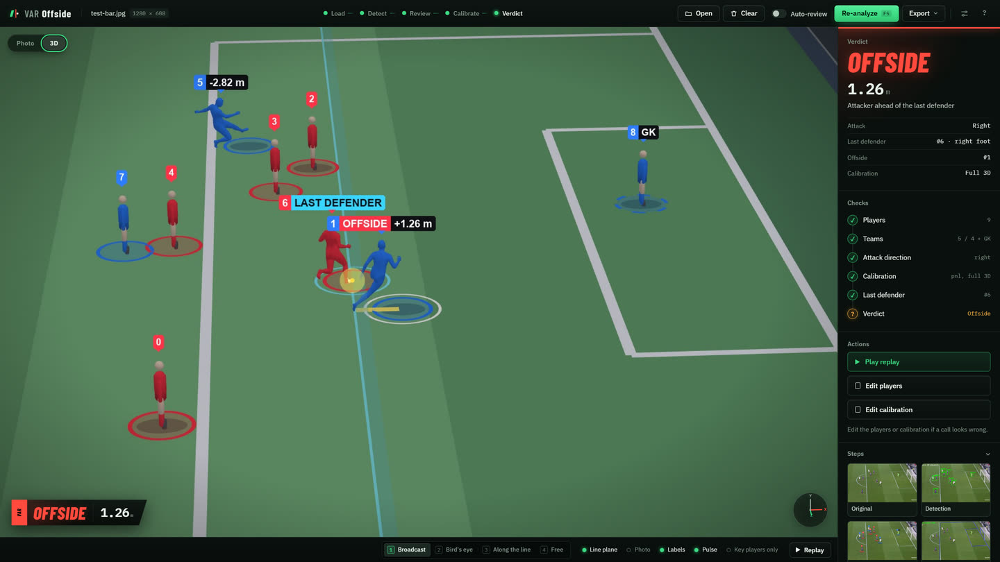
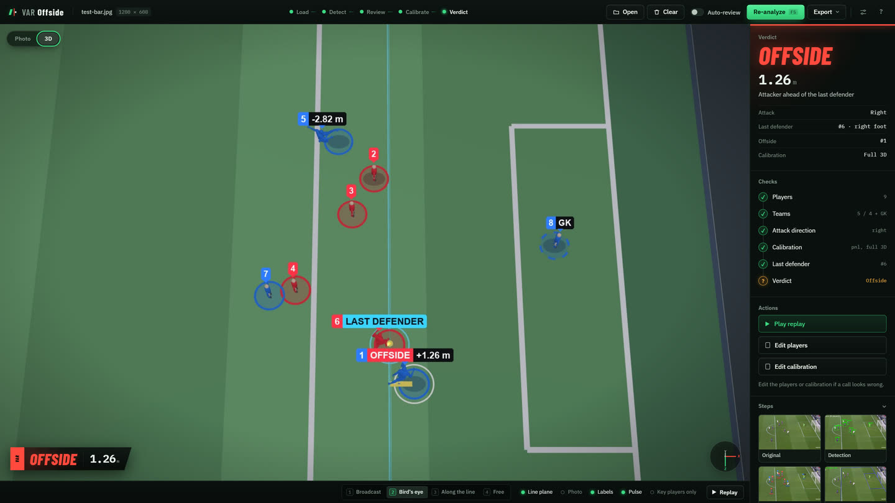
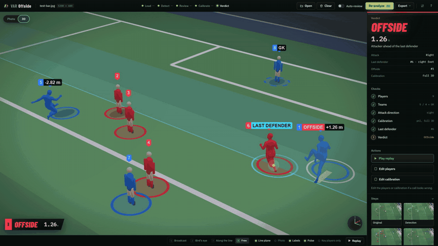

<h1 align="center">VAR-Offside</h1>

<p align="center"><b>Offside detection for football broadcast frames, reviewed in your browser and rebuilt in 3D.</b></p>

<p align="center">
  <a href="https://github.com/Yousef-Nasr/var-offside/actions/workflows/ci.yml"></a>
  <a href="https://yousef-nasr.github.io/var-offside/"></a>
  <a href="LICENSE"></a>
  <a href="pyproject.toml"></a>
</p>

<p align="center">
  
</p>

Drop a broadcast frame or clip into the web app. VAR-Offside finds the players and their body parts, solves the camera against the pitch markings, draws the offside line through the second-last defender, and tells you who is ahead of it, with the margin in metres. Then it rebuilds the play in 3D, with every player standing exactly where the decision placed them.

<p align="center">
  <a href="docs/assets/readme/demo.mp4"></a>
  <br>
  <a href="docs/assets/readme/demo.mp4"><b>▶ Watch the 54-second demo</b></a>
</p>
<!-- For an inline player on GitHub: edit this README on github.com and drag demo.mp4 into the editor,
     then replace the poster block above with the user-attachments URL it gives you. -->

## From one frame to a decision

| 1. Review | 2. Calibrate |
|:---:|:---:|
|  |  |
| Players are detected with their pose and split into teams. You pick the attack direction, the attacking team and the keeper. Nothing is guessed. | The camera is solved against the pitch markings. Drag any yellow line that misses, or place the pitch by hand. |
| **3. Verdict in 3D** | **4. Bird's-eye** |
|  |  |
| The second-last defender sets the line; head, body and feet count, arms don't. The margin is in metres on a real 105 × 68 m pitch. | Move around the moment live: broadcast, bird's-eye, along the line or free camera. Export the image, replay videos or a JSON report. |

## Features



- **Human in the loop.** Every stage pauses for review: fix a team, mark the keeper, drag the pitch lines.
- **Law-aware line.** The second-last defender, counting the keeper, sets the line. Arms never count.
- **Metric margins.** With a solved camera, players are compared on the real pitch, in metres.
- **Calibration that tells you when it's wrong.** Automatic ([PnLCalib](https://github.com/mguti97/PnLCalib)), hand placement with named warnings, or a classical fallback.
- **Live 3D view.** Players rebuilt as 3D bodies with [SAM 3D Body](https://github.com/facebookresearch/sam-3d-body), placed exactly where the decision put them, with the body part that sets the line highlighted.
- **Exports.** Overlay image, replay and bird's-eye videos, and a JSON report.
- **Auto-review (optional).** A vision language model runs the review steps and shows every correction, with undo.
- **Runs locally.** Your frames stay on your machine unless you switch on Auto-review.

<br clear="right">

## Quick start

```bash
git clone https://github.com/Yousef-Nasr/var-offside.git
cd var-offside
python -m venv .venv && source .venv/bin/activate     # Windows: .venv\Scripts\activate

pip install torch torchvision --index-url https://download.pytorch.org/whl/cu121   # pick yours at pytorch.org
pip install -e .                        # everything, including the 3D view

hf auth login                           # once, for the gated SAM 3D Body checkpoint
python scripts/download_weights.py      # models into weights/, upstream code into third_party/
python scripts/verify_setup.py          # check what's ready

var-offside-web                         # opens http://127.0.0.1:8765
```

No models yet? Open <http://127.0.0.1:8765/?mock=1> to try the interface with made-up data.

From the command line:

```bash
var-offside --image frame.png --attacking-side left --attacking-team 1 --no-display
```

## Models

The models aren't in git. `scripts/download_weights.py` puts them in [`weights/`](weights/), and upstream code goes in [`third_party/`](third_party/):

| Feature | Files | Licence |
|---|---|---|
| Detection | `best_tuned.pt`, `yolo11x-pose.pt` | AGPL-3.0 |
| Automatic calibration | PnLCalib `SV_kp`, `SV_lines` + code | GPL-2.0 |
| 3D view with real player bodies | SAM 3D Body checkpoint + code ([request access](https://huggingface.co/facebook/sam-3d-body-dinov3)) | SAM License |

Until the SAM 3D Body checkpoint is in place, the 3D view uses stand-in players. **[Models and weights](docs/getting-started/models.md)** explains where to download each file and where to put it.

## Configuration

Everything works with the defaults. To change them, `cp config.example.yaml config.yaml` and edit. See [Configuration](docs/getting-started/configuration.md).

## Documentation

| | |
|---|---|
| [Installation](docs/getting-started/installation.md) | Python, PyTorch, OpenGL |
| [Models and weights](docs/getting-started/models.md) | What to download and where it goes |
| [Quickstart](docs/getting-started/quickstart.md) | Your first call |
| [Web app guide](docs/guide/web-app.md) | Every step and control |
| [How it works](docs/concepts/pipeline.md) | Pipeline, [offside rules](docs/concepts/offside-rules.md), [calibration](docs/concepts/calibration.md), [3D](docs/concepts/3d-replay.md) |
| [Python API](docs/reference/python-api.md) · [Web API](docs/reference/web-api.md) | For your own tools |
| [Troubleshooting](docs/troubleshooting.md) | When something goes wrong |

Build the docs site locally with `pip install -e ".[docs]" && mkdocs serve`.

## Project layout

```text
var_offside/        the package: detection, teams, calibration, offside, visualization, agent, web
tests/              pytest suite (no weights or GPU needed)
scripts/            download_weights, verify_setup, smoke tests
docs/               documentation (MkDocs)
weights/            model files (downloaded, not in git)
third_party/        upstream clones (not in git)
```

## Contributing

Bug reports, wrong calls and pull requests are welcome. See [CONTRIBUTING.md](CONTRIBUTING.md), and run `pytest` before you open a PR.

## Responsible use

VAR-Offside is a research and learning tool. It isn't a certified officiating system and isn't affiliated with FIFA, IFAB, any league or any club. Very close calls can be smaller than the calibration's own error. You're responsible for having the rights to the footage you analyse. See [Responsible use](docs/about/responsible-use.md).

The screenshots above show a broadcast frame for illustration only; all rights to the footage belong to its owners.

## Licence

[AGPL-3.0-or-later](LICENSE). Third-party models and code keep their own licences; see [Licensing](docs/about/licensing.md) and [THIRD_PARTY_NOTICES.md](THIRD_PARTY_NOTICES.md).

## Acknowledgements

Built on [Ultralytics YOLO](https://github.com/ultralytics/ultralytics), [PnLCalib](https://github.com/mguti97/PnLCalib), [SAM 3D Body](https://github.com/facebookresearch/sam-3d-body), [Fast-SAM-3D-Body](https://github.com/yangtiming/Fast-SAM-3D-Body), [PyTorch](https://pytorch.org), [FastAPI](https://fastapi.tiangolo.com) and [pyrender](https://github.com/mmatl/pyrender).
