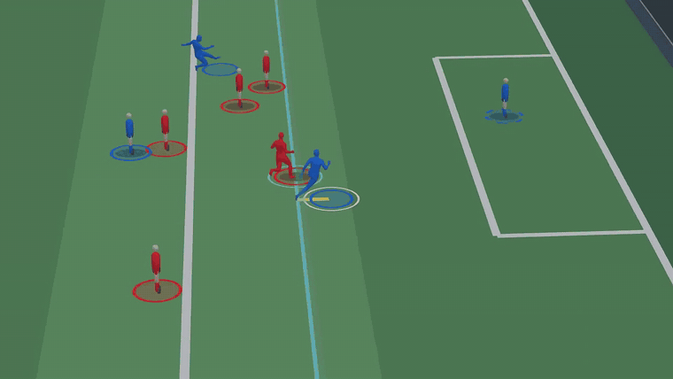

# 3D view and replay

With a full camera calibration, VAR-Offside rebuilds the play on a 3D pitch: players stand where the decision placed them, and a vertical plane shows the offside line. You can move around it live in the browser and export replay videos.

It's part of every install and needs a working OpenGL driver. Real player bodies also need the SAM 3D Body checkpoint; see [Models](../getting-started/models.md#4-real-player-bodies-sam-3d-body).

## How players are placed

The 3D scene must agree with the 2D verdict, so it reuses the decision's numbers instead of estimating anything again:

- Each player stands at the **same pitch position the decision used**: the direction-aligned ground point projected through the calibrated camera.
- The offside plane is placed at the decision's line position in metres along the pitch.
- The defender who sets the line gets an ice-blue ring, and the body part that sets it is highlighted. An offside attacker gets a white ring.

## Stand-ins, then bodies

The view opens straight away with simple stand-in players. In the background, [SAM 3D Body](https://github.com/facebookresearch/sam-3d-body) rebuilds each player as a full mesh from their box in the photo, and the stand-ins are swapped for real bodies as they're ready. The first time took about 70 seconds on a laptop RTX 3050, and later frames are faster because the model stays loaded.

With [Fast-SAM-3D-Body](https://github.com/yangtiming/Fast-SAM-3D-Body) in `third_party/`, the bodies are about 10 times faster. `visualization/sam3d_setup.py` picks it automatically.

If the bodies can't be built (no checkpoint, out of GPU memory), the stand-ins stay and the status chip says why. The verdict doesn't depend on the bodies.

## Without a full camera

A real 3D pitch needs the full camera that PnLCalib or hand placement produce. With only a vanishing-point line, the web app shows the photo view and explains why there's no 3D.

## Exports

| Export | What it shows |
|---|---|
| Replay video | A broadcast-style move around the play |
| Bird's-eye video | The play from above |
| Debug video | Each analysis step |

**Key players only** limits the view and the replay and bird's-eye exports to the line-setting defender and the attacker.

## Code

| File | Role |
|---|---|
| `web/live3d.py` | The live scene streamed to the browser |
| `visualization/var_3d.py` | Mesh recovery, scene building and video rendering |
| `visualization/sam3d_setup.py` | Loads SAM 3D Body from `third_party/` |
| `offside/mesh_offside.py` | The optional mesh-based offside method (`offside_method="mesh_3d"`) |

Everything that opens an OpenGL context runs on one render thread. See [Architecture](../development/architecture.md).
