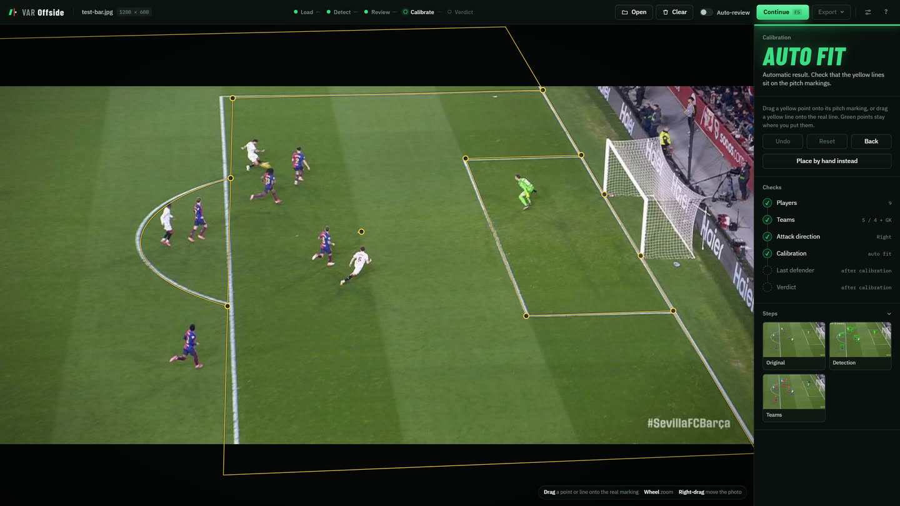

# Calibration

Calibration tells the app where the pitch is in the image. With it, players can be placed on the real 105 × 68 m pitch and compared in metres. Without it, they can only be compared in pixels along a line drawn towards the vanishing point.

All methods produce the same `CalibrationResult` (`calibration/base.py`): a homography between the image and the pitch plane, and, when possible, a full camera (intrinsics, rotation and position) for the 3D view. Pitch coordinates are in metres from one corner: x runs 0 to 105 along the length (the halfway line is at 52.5) and y runs 0 to 68 across.

## Methods

| Method | Code | Needs | Gives |
|---|---|---|---|
| **PnLCalib** | `calibration/pnl_calibration.py` | `third_party/PnLCalib` and its weights | Full camera. The best automatic result |
| **Vanishing point** | `calibration/vanishing_point.py` | Nothing | Line direction only, no metric margin |
| **Hand placement** (web app) | `calibration/pitch_solver.py` | You, clicking pitch points and lines | Full camera |
| **Manual** (CLI) | `calibration/manual_calibration.py` | A desktop window | Homography |
| **Auto** (default) | `calibration/factory.py` | | PnLCalib, falling back to vanishing point |

### PnLCalib

[PnLCalib](https://github.com/mguti97/PnLCalib) (Gutiérrez-Pérez and Agudo) detects pitch keypoints and line ends with two HRNet models, then solves the camera with PnP and line refinement. Its score (`quality_score`, 1 minus the reprojection error over 20 px) decides whether the result is trusted. See [Models](../getting-started/models.md#2-automatic-calibration-pnlcalib) to install it.

### Hand placement

In the web app's Calibrate step you can drag the automatic pitch lines onto the real markings, or place points from scratch: click a spot on the pitch map, then the same spot in the photo. Four points spread far apart are the minimum and a fifth confirms the fit. Dragging a whole line helps when few corners are visible.

`pitch_solver.py` solves the camera from these points and lines, then checks the result: points too close together, points that disagree with the rest, or a camera that contradicts the attack direction all produce a named warning instead of a silent bad fit. The status names are listed in the [web app guide](../guide/web-app.md#4-calibrate).

### Vanishing point

The classical fallback finds the grass by colour, detects straight lines with a Hough transform, and estimates where the pitch's length-wise lines meet with RANSAC. That gives the direction of an offside line through any point, but not distances, so calls are marked **Estimate**. Its parameters are in the `calibration` section of [`config.yaml`](../getting-started/configuration.md).

## When the camera isn't believable

An automatic result can score well and still be wrong, for example on a close-up or a frame with few visible lines. The web app checks every camera before using it and refuses one it calls **NOT BELIEVABLE**; the verdict panel then says why. Always check the yellow lines by eye.

## Tips

- Frames with the penalty box, the halfway line or the centre circle in view calibrate best.
- Each video frame starts from a fresh automatic calibration, because broadcast cameras move.
- Editing players keeps the calibration; changing the frame drops it.
