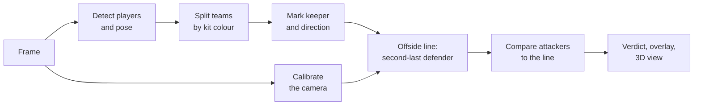

# How it works

VAR-Offside turns one broadcast frame into an offside decision in a fixed sequence of stages. The web app pauses between stages so a person can check and correct each one; the CLI and Python API run them straight through.

## Stages

| # | Stage | Code | Output |
|---|---|---|---|
| 1 | Load the frame | `pipeline.py` | BGR image |
| 2 | **Calibrate** the camera against the pitch | `calibration/` | Homography image ↔ pitch, and a full camera when possible |
| 3 | **Detect** players, keepers, referees and the ball, plus 17 pose keypoints per player | `detection/player_detector.py` | `PlayerDetection` list |
| 4 | **Split teams** by kit colour: ResNet-50 embeddings of the upper body, clustered into two groups | `teams/` | Team 1 or 2 per player |
| 5 | **Goalkeepers**: a likely keeper per team from position and kit. In the web app you confirm or change it | `detection/goalkeeper_filter.py` | Keeper per team |
| 6 | **Attack direction** and attacking team: given by the user | `offside/side_detector.py` | `left` or `right` |
| 7 | **Offside line** through the second-last defender's most advanced body part | `offside/line_calculator.py` | `OffsideLine` |
| 8 | **Decision**: each attacker's most advanced body part against the line | `offside/decision.py` | `OffsideResult` with margins |
| 9 | **Visualise**: overlay, bird's-eye view, optional 3D replay | `visualization/`, `web/live3d.py` | Images and video |

The attacking team, direction and keeper are not guessed. A guess from one frame isn't reliable, and a wrong one silently flips the decision, so the user chooses them (or [Auto-review](../guide/auto-review.md) asks a vision model and shows its answer).

## Two ways to measure

**Calibrated (metric).** When the camera is solved, every player's ground point is projected onto the pitch and compared in metres along the pitch's length. The margin is shown in metres, and anything above 0 m is offside.

**Uncalibrated (image).** Without a usable camera, the line is drawn in the image towards the vanishing point and players are compared in pixels, with a 3 px tolerance. The call is marked **Estimate** and has no metric margin.

See [Offside rules](offside-rules.md) for exactly what counts, and [Calibration](calibration.md) for how the camera is solved.

## Three front ends, one pipeline

| Front end | Entry point | Best for |
|---|---|---|
| Web app | `var_offside/web/` (`var-offside-web`) | Reviewing and correcting calls, 3D view, exports |
| CLI | `var_offside/demo.py` (`var-offside`) | Scripts and batch runs |
| Python | `var_offside.OffsidePipeline` | Your own tools and experiments |

The web app doesn't call `OffsidePipeline.analyze` in one go. `web/phases.py` runs the same components in separate steps, so detection, review, calibration and the verdict can each be revisited without rerunning the rest.
