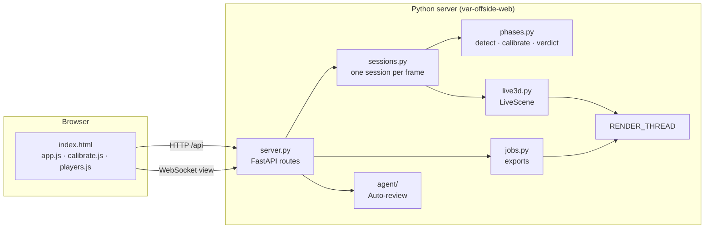

# Architecture

## Repository layout

```text
var-offside/
├── var_offside/                  # the package
│   ├── config/                   # settings dataclasses, config.yaml loader, path lookup
│   ├── detection/                # YOLO detector + pose, body parts, goalkeepers
│   ├── teams/                    # ResNet-50 kit embeddings and clustering
│   ├── calibration/              # PnLCalib, vanishing point, hand-placement solver
│   ├── offside/                  # line, decision, optional mesh method
│   ├── visualization/            # overlays, bird's-eye view, 3D scene and video
│   ├── agent/                    # Auto-review: rule checks, vision checks, run policy
│   ├── web/                      # FastAPI server, sessions, jobs, live 3D, static page
│   ├── pipeline.py               # OffsidePipeline: all stages in one call
│   └── demo.py                   # the var-offside CLI
├── tests/                        # pytest suite; no weights or GPU needed
├── scripts/                      # download_weights, verify_setup, smoke tests
├── docs/                         # this site (MkDocs)
├── weights/                      # model files (not in git)
├── third_party/                  # upstream clones (not in git)
├── config.example.yaml
└── pyproject.toml
```

## The web app



- **Sessions** (`sessions.py`) hold one frame and everything derived from it, in memory only. Restarting the server clears them; exports in `results/` stay.
- **Phases** (`phases.py`) run the pipeline components step by step, so the user can review between them. They import nothing from the GUI or the server.
- **Jobs** (`jobs.py`) render exports on background threads and report progress.
- **The live 3D view** (`live3d.py`) renders frames on the server and streams them over the WebSocket described in [Web API](../reference/web-api.md).
- **The page** (`static/`) is plain HTML, CSS and JavaScript with no build step. `mock.js` fakes the API for `?mock=1`.

## Rules that are easy to break

- **Everything that opens an OpenGL context runs on the one render thread** (`sessions.RENDER_THREAD`), video exports included. Opening one on any other thread fails once a window exists, especially on Windows.
- **Run the analysis before body recovery in your own scripts.** Loading SAM 3D Body first has made the process exit silently (code 127) on a laptop with AMD integrated graphics plus an NVIDIA GPU. The app's normal flow isn't affected.
- **The 3D scene must agree with the 2D verdict.** Place players with the decision's ground points and line position; don't estimate them again from the meshes.
- **Never guess the attacking team, direction or keeper.** Ask the user, or have Auto-review ask the model and show the answer.
- **Paths go through `var_offside.config.paths`.** Don't build paths from the current working directory or `__file__` elsewhere.

## Configuration

`config/settings.py` defines one dataclass per section. `get_settings()` builds them once from the defaults plus `config.yaml`, and every module reads that shared object. To add a setting, add a field with a default to the right dataclass and document it in `config.example.yaml` and [Configuration](../getting-started/configuration.md). Unknown keys in `config.yaml` are rejected, so the example file and the dataclasses must stay in step; `tests/test_config.py` loads the example to check that.
