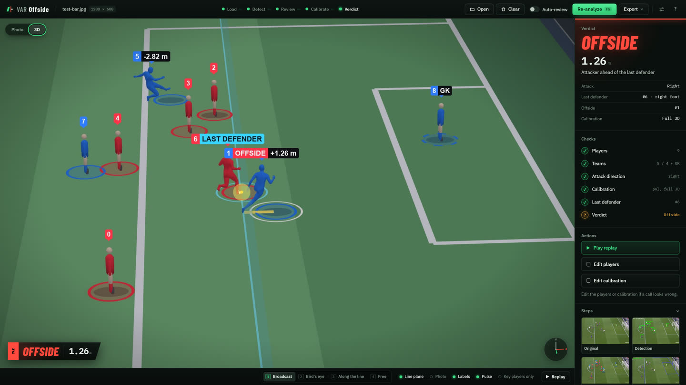

# Web app

How to run and use the browser app, and what to do when something goes wrong.



The app runs on your own computer. A Python server does the detection, calibration and 3D rendering, and your browser shows the result. Set it up first with [Installation](../getting-started/installation.md) and [Models](../getting-started/models.md).

## Run the server

| Task | Command |
|---|---|
| Start, and open the browser | `var-offside-web` |
| Start without opening a browser | `var-offside-web --no-browser` |
| Use another port | `var-offside-web --port 8770` |
| Use a specific config file | `var-offside-web --config my-config.yaml` |
| Check it's up | `curl http://127.0.0.1:8765/api/health` |

`python -m var_offside.web` does the same as `var-offside-web`. Defaults for host, port and opening the browser come from the `server` section of [`config.yaml`](../getting-started/configuration.md).

A healthy server answers `{"status":"ok","device":"cuda"}`. If `device` says `cpu`, the GPU isn't being used and 3D bodies will be slow.

### Stop or restart

Press **Ctrl+C** in the server's window. If it's running in the background, stop the process listening on port 8765:

```bash
# Linux / macOS
kill $(lsof -t -i :8765)
```

```powershell
# Windows PowerShell
Get-NetTCPConnection -LocalPort 8765 -State Listen | ForEach-Object { Stop-Process -Id $_.OwningProcess -Force }
```

**Restart after changing Python code.** Changes to the page's own files (`var_offside/web/static/`) only need a browser refresh with **Ctrl+F5**.

Restarting loses open sessions, because they're kept in memory only. Finished exports stay in `results/`.

> **Keep it local.** The server has no login. `--host 0.0.0.0` would let anyone on your network open it and upload files, so use that only on a network you trust.

## Make a call

The steps along the top of the page show where you are. **F5** always runs the main button.

### 1. Load

Drop a photo or clip on the page, or press **Ctrl+O**. Accepted files include PNG, JPG, MP4 and MOV. For a clip, move the timeline to the moment of the pass.

### 2. Detect

Press **Detect**. The first run is slower because the models load.

### 3. Review

Fix anything the detector got wrong:

- Each player has a ring under their feet and a label above their head. **Team 1 is always red and Team 2 always blue**, whatever the kits look like, so a real team can get either colour. A dashed ring marks a goalkeeper.
- Nothing is chosen for you: no keeper is marked and no direction is suggested.
- **Click a player** to switch team, mark as goalkeeper, or mark as not a player. There is only one keeper, so marking a new one replaces the last.
- **Drag a box** on empty space to add a missed player, then choose the team.

Then make the three choices on the review card. **Calibrate** stays disabled until all three are made, and the card says what is still needed:

- **Attack direction:** press ← or →, or use the two buttons.
- **Attacking team:** Team 1 or Team 2.
- **Keeper:** mark the keeper on the photo, or press **Not in frame** if the keeper isn't visible. With a keeper marked, the line is the second-last defender counting the keeper. With no keeper in frame, it's the last visible defender.

Editing players keeps your direction and team. A new Detect, file or frame clears them.

Then press **Calibrate**.

### 4. Calibrate

The pitch is drawn in yellow over the photo. The verdict stays hidden on this screen, so that nobody adjusts the pitch until they like the answer.

**If the yellow lines sit on the real markings,** press F5.

**If they miss,** drag them into place:

- Drag a yellow **point** onto the marking it names. Hover over a point to see its name.
- Drag a yellow **line** onto the real line. This helps when few corners are visible.
- Green points stay where you put them. A magnifier shows the exact spot while you drag.

**If no automatic result is available,** the screen opens in hand placement:

1. Click a spot on the pitch map, or use the one already highlighted.
2. Click the same spot in the photo.
3. Repeat. Four points far apart are the minimum, and a fifth confirms the fit. On the map, the camera side is at the bottom.

Can't get a fit? **Continue without 3D** gives a flat line in the photo instead.

| Control | Action |
|---|---|
| Wheel | Zoom the photo |
| Right-drag | Move the photo |
| Double-click empty space | Reset the zoom |
| Arrow keys | Nudge the selected point by 1 pixel |
| Shift + arrow keys | Nudge it by 5 pixels |
| Delete | Release the selected point |
| Ctrl+Z | Undo |

What the status means:

| Status | Meaning | What to do |
|---|---|---|
| FINDING THE PITCH | Automatic calibration is still running | Wait, or start placing by hand |
| AUTO FIT | Automatic result with a good score | Check the lines by eye, then continue |
| WEAK AUTO FIT | Automatic result looks unsure | Drag what misses |
| 2D ONLY | Only a flat line, no 3D | Place by hand for 3D, or continue |
| NOT FOUND, NOT BELIEVABLE | No usable automatic result | Place by hand, or continue without 3D |
| ADJUSTED | Your edit fits | Apply and continue |
| PLACE N MORE | Not enough points yet | Add more, far apart |
| TOO CLOSE TOGETHER | Points are bunched, so the camera would be wrong | Add one farther away, across the pitch |
| CHECK IT | The minimum is placed, but nothing confirms it | Add one more |
| WEAK FIT | Usable, but the line could be off | Add points farther apart |
| GOOD FIT | The points agree | Apply and continue |
| POINTS DISAGREE | One point doesn't fit, and it's named | Move that point |
| CHECK THE END | The fit contradicts your attack direction | Check you used the right end of the pitch |

> A green status isn't proof. An automatic result can score well and still be wrong, so always check the lines by eye.

### 5. Verdict and 3D

The panel shows the call and the margin in metres. A plus margin means the attacker is past the line. Without a trusted full 3D calibration, the call is marked **Estimate**: it comes from the drawn line and has no margin in metres. A camera the Calibrate screen calls NOT BELIEVABLE is not used, and the panel says so. **No call** means something is missing, and the panel says what. In the Photo view, the last defender gets an ice-blue outer ring and the offside attacker a slowly pulsing white one. The 3D view opens with stand-in players, then swaps in real bodies, which took about 70 seconds the first time on the development machine. You can move around while they load.

| Control | Action |
|---|---|
| Drag | Orbit |
| Right-drag, or Shift + drag | Pan |
| Wheel | Zoom toward the cursor |
| 1, 2, 3, 4 | Broadcast, Bird's eye, Along the line, Free |
| R | Back to the Broadcast camera |
| Space | Play or stop the replay |
| Tab | Switch between Photo and 3D |

The 3D players are red and blue like the photo view, each with a ring on the pitch. The last defender gets an extra ice-blue ring, and an offside attacker a white one.

The switches in the bottom bar are **Line plane**, **Photo**, **Labels**, **Pulse** and **Key players only**. Key players only shows just the last defender and the attacker, and also applies to the replay and to Replay and Bird's-eye video exports.

**If a call looks wrong,** use the Actions list:

- **Edit calibration** reopens step 4 with your earlier edits. After you apply, the panel shows the old call and how far the line moved. Body poses are reused, so there's no long wait.
- **Edit players** goes back to step 3.

### 6. Export

Use the **Export** menu. Files are saved in `results/` and offered as a download.

| Export | Format | Contents |
|---|---|---|
| Image with overlay | PNG | The frame with the line and the call |
| Replay video | MP4 | The cinematic replay |
| Bird's-eye video | MP4 | The play seen from above |
| Debug video | MP4 | Each analysis step. Ignores Key players only, and pauses the live view while it renders |
| Report | ZIP | `result.png` and `report.json`. The JSON holds the players, the verdict, the automatic calibration, your points and the final calibration |

## Auto-review

Auto-review is an optional switch next to the main button that runs the review steps for you with a vision language model. It's off by default and needs an OpenRouter key. See [Auto-review](auto-review.md).

## Clearing a frame

**Clear** deletes the frame and everything made from it, and returns to the empty screen: the uploaded file, detections, results, body meshes, any Auto-review run, and export files on the server. Opening a new file does the same to the old one once the new file has loaded. Files you already downloaded stay, and the loaded AI models stay in memory, so the next frame starts faster.


## Good to know

- **Each video frame starts from the automatic calibration.** Moving to another frame drops your edits, because broadcast cameras move.
- **Editing players keeps your calibration.** The pitch depends on the frame, not the players.
- **Offside tolerance:** on a calibrated frame, any margin above 0 m is offside. Without calibration, the line is compared in image pixels with a 3 px tolerance, and no margin in metres is shown.
- **Accuracy has limits.** Very close calls can be smaller than the calibration's own error, so treat them with care. The app assumes a 105 × 68 m pitch, so points at both ends of a pitch of another size won't fit well.
- **The verdict is an aid.** It depends on the detected players, so check the last defender it picked.

## Troubleshooting

| What you see | Likely cause | Fix |
|---|---|---|
| `error while attempting to bind` on start | The port is in use, often by an old server | Stop it with the command above, or use `--port` |
| The page looks old or a button is missing | The browser is using cached files | Press Ctrl+F5 |
| A **Mock data** badge in the top bar | The page can't reach the server, or the address has `?mock=1` | Check the server is up, remove `?mock=1`, and reload |
| Page won't load | The server isn't running | Start it, and check the health command |
| Calibration always says NOT FOUND | PnLCalib code or weights are missing | Run `python scripts/verify_setup.py` and see [Models](../getting-started/models.md) |
| Stand-in players never become bodies | Body model files are missing, or the GPU is out of memory | Read the status chip and the server window, then run `verify_setup.py` |
| Black 3D view, or the view disconnects | The renderer hit a problem | Click **Reconnect**. If that fails, restart the server |
| Video won't play in the browser | ffmpeg wasn't found, so the file stayed in an older format | Install ffmpeg on PATH, or `pip install imageio-ffmpeg` |
| Video exports are very slow | Running on the CPU | Check the health command says `cuda` |

The server window logs every error, so look there first.

## Try it without models

Mock mode runs the whole interface with made-up data, and no detection or calibration runs:

<http://127.0.0.1:8765/?mock=1>

Use it to look at the interface. Its verdicts and fits mean nothing.

## For developers

See [Architecture](../development/architecture.md) for how the server, the render thread and the page fit together, and [Web API](../reference/web-api.md) for the HTTP and WebSocket contract.
