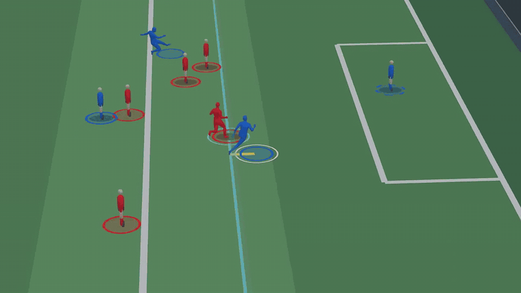
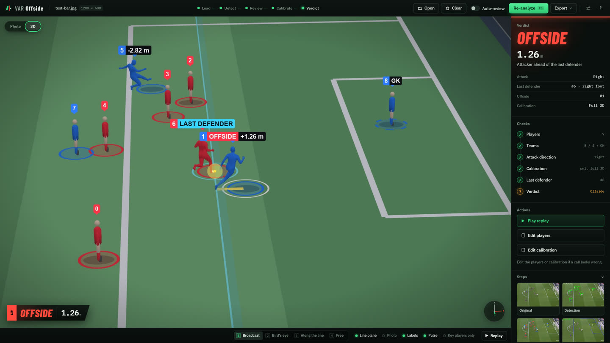

# VAR-Offside

**Offside detection for football broadcast frames, reviewed in your browser and rebuilt in 3D.**

Drop a broadcast frame or clip into the web app. VAR-Offside finds the players and their body parts, solves the camera against the pitch markings, draws the offside line through the second-last defender, and tells you who is ahead of it, with the margin in metres. Then you can walk around the play in a live 3D view.

-   **Get started**

    Install, download the models and make your first call.

    [Installation](getting-started/installation.md) · [Models](getting-started/models.md) · [Quickstart](getting-started/quickstart.md)

-   **Use it**

    The browser app step by step, the command line, and the optional Auto-review.

    [Web app](guide/web-app.md) · [Command line](guide/cli.md) · [Auto-review](guide/auto-review.md)

-   **Understand it**

    The pipeline, exactly which offside rules are applied, and how the camera is solved.

    [How it works](concepts/pipeline.md) · [Offside rules](concepts/offside-rules.md) · [Calibration](concepts/calibration.md)

-   **Build on it**

    Python API, web API, configuration and how to contribute.

    [Python API](reference/python-api.md) · [Web API](reference/web-api.md) · [Contributing](development/contributing.md)

[▶ Watch the 54-second demo](assets/readme/demo.mp4)

## Features

- **Human in the loop.** Every stage pauses for review: fix a team, mark the keeper, drag the pitch lines. Nothing is guessed for you.
- **Law-aware line.** The second-last defender (counting the keeper) sets the line; head, body and feet count, arms don't.
- **Metric margins.** With a solved camera, players are compared on a real 105 × 68 m pitch in metres.
- **Calibration that tells you when it's wrong.** Automatic (PnLCalib), hand placement with named warnings, or a classical fallback.
- **Live 3D view.** Players rebuilt as 3D bodies with SAM 3D Body, placed exactly where the decision put them.
- **Exports.** Overlay image, replay and bird's-eye videos, and a JSON report.
- **Runs locally.** Your frames stay on your machine unless you switch on Auto-review.

## What you need

| | |
|---|---|
| Python | 3.10 or newer |
| GPU | Optional for the decision; a CUDA GPU for real 3D bodies |
| Models | Downloaded once with `python scripts/download_weights.py` |

!!! note "An aid, not an official"
    VAR-Offside is a research tool and isn't affiliated with FIFA, IFAB or any league. Read [Responsible use](about/responsible-use.md) before you share its output.
